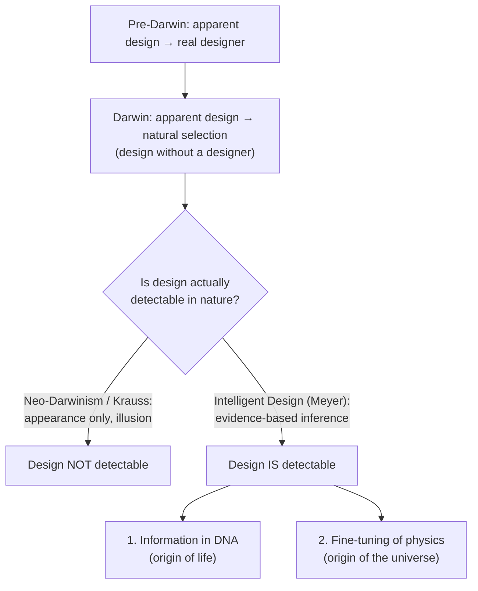

# The Core Question

Before Darwin, biologists attributed life's organized complexity to a designing intelligence. Darwin proposed that natural selection + random variation could produce the *appearance* of design without an actual designer. Modern neo-Darwinists extended this to all of biology; some physicists now make an analogous move for cosmic fine-tuning (attributing it to "the illusion of design").

Meyer's essay argues the opposite: design is not just apparent, but **scientifically detectable**, on two independent lines of evidence.

