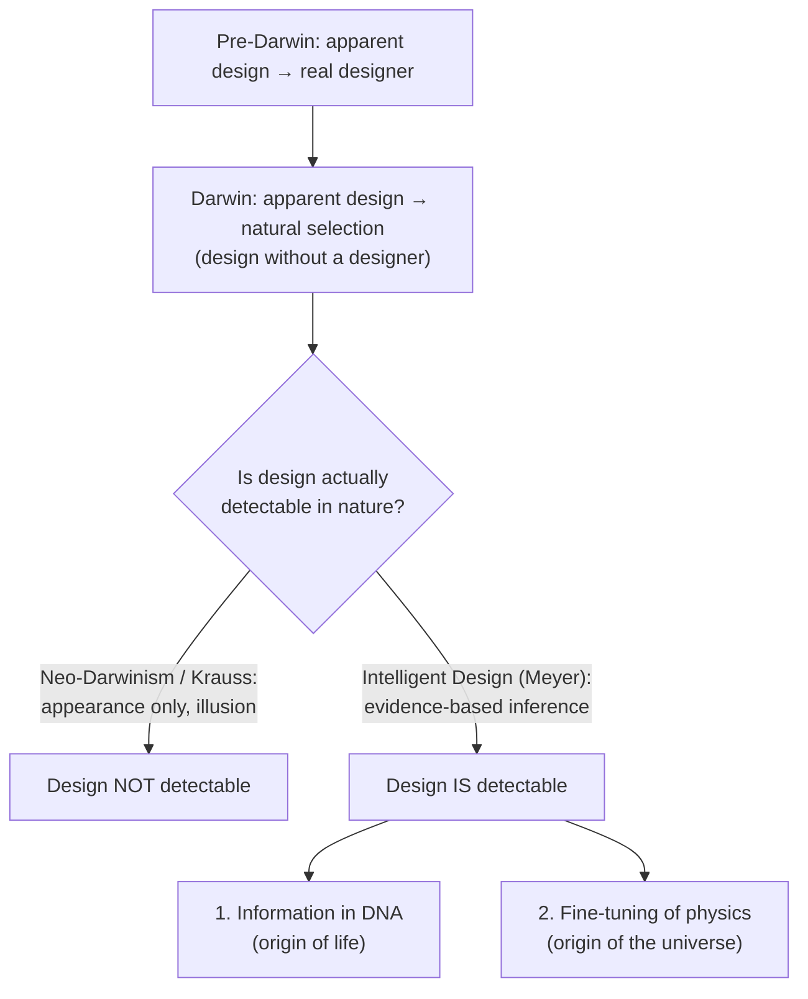

# The Core Question

### The scene

Cambridge, England, around 1830. A young student named Charles Darwin is preparing for his exams, and one author delights him: William Paley. Paley's best-known argument is simple. If you find a watch lying on the ground, you know a watchmaker made it. Living things are far more intricate than any watch, so they too must have a maker. Darwin later wrote that Paley's logic "gave me as much delight as did Euclid." [Source: [Darwin, *Autobiography*](https://monadnock.net/darwin/autobiography-2.html)]

About thirty years later, the same man published the book that convinced much of the world the watchmaker was not needed.

### The question

Before Darwin, biologists explained the ordered complexity of life the way Paley did: a designing mind made it. Darwin proposed that natural selection, working on random variation, could produce the *appearance* of design with no designer at all. Modern neo-Darwinists extended that idea to all of biology. Some physicists now say something similar about the universe: its fine-tuning for life is only "the illusion of design."

Meyer's essay argues the opposite. Design is not only an appearance. It is **scientifically detectable**, and two independent lines of evidence show it.

**Darwin did not deny that life looks designed. He denied that the look is true. Meyer's essay reopens that question.**
