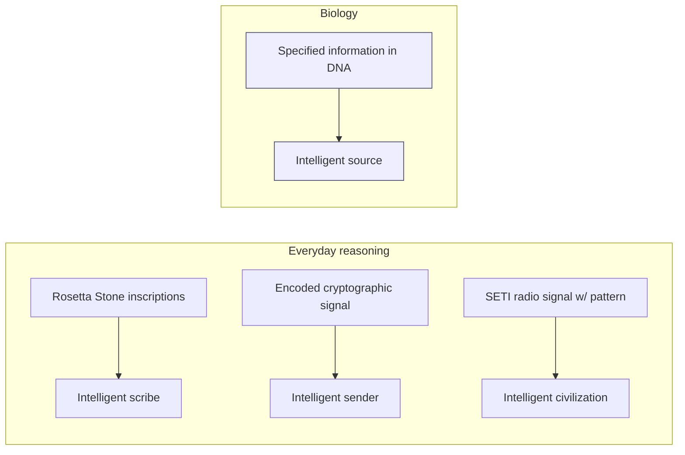

# Line of Evidence #1 — Information in DNA

### The discovery
- **1953** — Watson & Crick: DNA stores information as a four-character digital code (the nucleotide bases).
- **Crick's "sequence hypothesis"**: the bases of DNA work like letters or symbols. Their order decides what they do, exactly as in written language or computer code.
- DNA has more than *Shannon information* (a sequence that is merely improbable). It has **specified, or functional, information**: a sequence that is complex *and* does a specific job.

> "DNA is like a computer program, but far, far more advanced than any software we've ever created." — Bill Gates
> "The machine code of the genes is uncannily computer-like." — Richard Dawkins

### The design-detection logic (Dembski)
How do we know when something came from a mind? We are confident when it shows **both** of these:
1. **High complexity** (it is very improbable, and no simple rule or formula produces it), **and**
2. **Specification** (it matches a pattern we can recognize independently, or it does a job).

| # | Sequence | Complex? | Specified? | Design inference |
|---|---|:---:|:---:|:---:|
| 1 | `nehya53nslbyw1'jejns7eopslanm46/J` | ✅ | ❌ | No — complex but meaningless |
| 2 | `TIME AND TIDE WAIT FOR NO MAN` | ✅ | ✅ | **Yes — both criteria met** |
| 3 | `ABABABABABABABABABABAB` | ❌ | ✅ (trivial/periodic) | No — ordered but not complex |

The coding regions of DNA meet **both** tests, just like sequence #2. We use this same reasoning every day in archaeology, code-breaking, fraud investigation and SETI (the search for signals from other civilizations). By that reasoning, specified information points to an intelligent source.

**Why not chance, law, or evolution itself?**
- *Chance* — far too improbable. There is simply too much information in the cell.
- *Law/chemistry* — a law explains regular, repeating order, not a specific message. (The chemistry of ink and paper does not explain a newspaper headline.)
- *Prebiotic natural selection* (selection before life existed) — it assumes the very thing it needs to explain: genetic information that is already there.

**Meyer's point: whenever we have traced a coded message back to its source, we have found a mind. He asks why DNA should be the one exception.**
