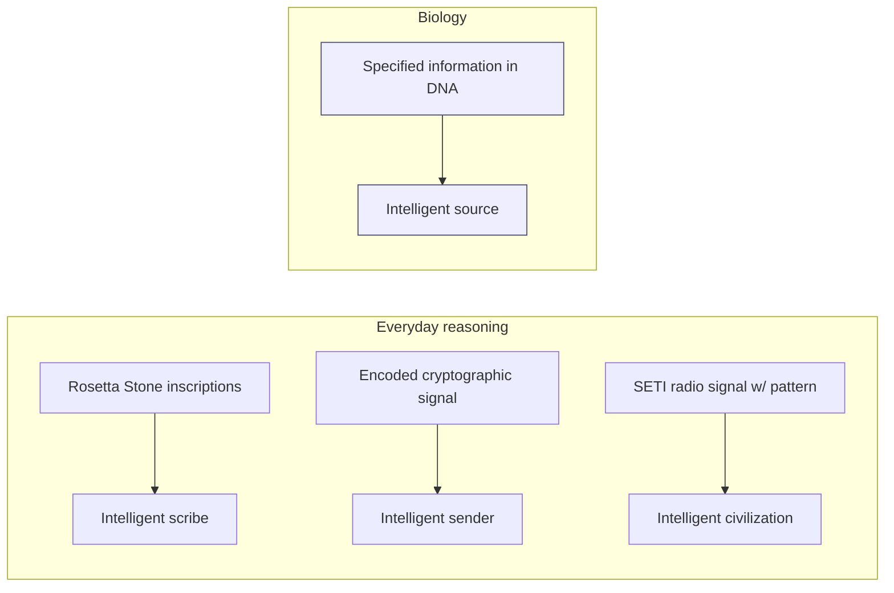

# Line of Evidence #1 — Information in DNA

### The discovery
- **1953** — Watson & Crick: DNA stores information as a four-character digital code (nucleotide bases).
- **Crick's "sequence hypothesis"**: DNA bases function like letters/symbols — arrangement determines function, exactly like written language or computer code.
- DNA has more than *Shannon information* (mathematical improbability) — it has **specified / functional information**: a sequence that both is complex *and* performs a specific function.

> "DNA is like a computer program, but far, far more advanced than any software we've ever created." — Bill Gates
> "The machine code of the genes is uncannily computer-like." — Richard Dawkins

### The design-detection logic (Dembski)
A system is confidently attributed to an intelligent cause when it exhibits **both**:
1. **High complexity** (small probability, defies a simple rule/algorithm), **and**
2. **Specification** (matches an independently recognizable pattern or functional requirement).

| # | Sequence | Complex? | Specified? | Design inference |
|---|---|:---:|:---:|:---:|
| 1 | `nehya53nslbyw1'jejns7eopslanm46/J` | ✅ | ❌ | No — complex but meaningless |
| 2 | `TIME AND TIDE WAIT FOR NO MAN` | ✅ | ✅ | **Yes — both criteria met** |
| 3 | `ABABABABABABABABABABAB` | ❌ | ✅ (trivial/periodic) | No — ordered but not complex |

DNA's coding regions meet **both** criteria — same as sequence #2 above — so by the same logic used every day in archaeology, cryptography, fraud investigation, and SETI, the presence of specified information licenses an inference to an intelligent source.

**Why not chance, law, or evolution itself?**
- *Chance* — far too improbable; there is simply too much information in the cell.
- *Law/chemistry* — explains regularity, not specified sequence (analogy: ink-paper chemistry doesn't explain a newspaper headline).
- *Prebiotic natural selection* — presupposes the very thing it needs to explain: preexisting genetic information.
