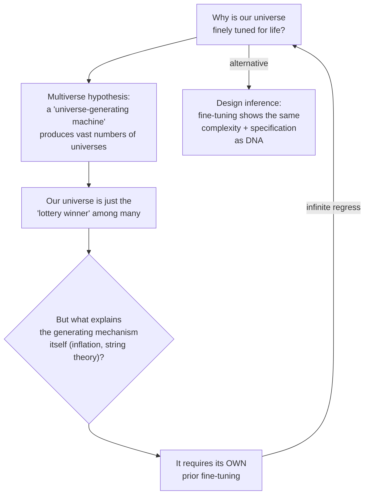

# Line of Evidence #2 — Cosmic Fine-Tuning

Since the 1950s–60s, physicists have found that the laws, constants, and initial conditions of the universe are finely tuned — against extreme odds — to permit life (and even basic chemistry). Examples cited: the universe's expansion rate, the speed of light, quark masses, gravitational/electromagnetic force strengths.

> "The impression of design is overwhelming." — Paul Davies
> "A commonsense interpretation of the facts suggests that a superintellect has monkeyed with physics." — Fred Hoyle

### The multiverse counter-argument, and its problem

Meyer's conclusion: every materialist explanation for fine-tuning ends up invoking further, unexplained fine-tuning — begging the question. Since fine-tuning exhibits the same **complexity + specification** signature that justifies design inferences elsewhere, intelligent design remains the better explanation.
