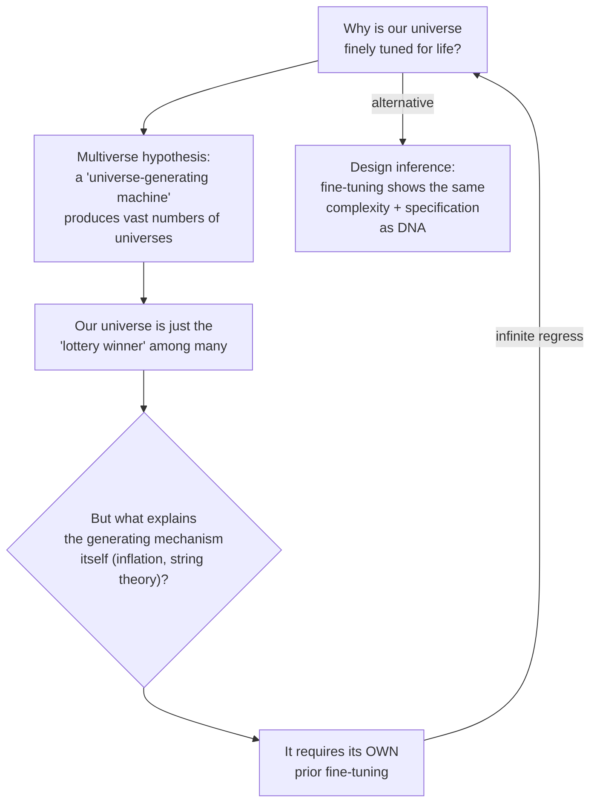

# Line of Evidence #2 — Cosmic Fine-Tuning

### The scene

Pasadena, California, 1953. The English astronomer Fred Hoyle is visiting Caltech, and he keeps pressing the nuclear physicist William Fowler with an odd request. Stars, he says, could never make carbon unless the carbon nucleus has a certain energy level, at 7.65 MeV, that nobody has measured. It has to be there, because we are made of carbon and we are here. Fowler is reluctant to spend weeks on it, but his group runs the experiment and finds the level where Hoyle said. "From that moment we took Hoyle very seriously indeed," Fowler recalled. [Source: [CERN Courier](https://cerncourier.com/?p=7653)]

Years later Hoyle wrote the line quoted below.

### What physicists found

Since the 1950s–60s, physicists have found that the laws, constants and starting conditions of the universe are finely tuned, against extreme odds, to permit life (and even basic chemistry). Examples cited: the universe's expansion rate, the speed of light, the masses of quarks, and the strengths of gravity and the electromagnetic force.

> "The impression of design is overwhelming." — Paul Davies
> "A commonsense interpretation of the facts suggests that a superintellect has monkeyed with physics." — Fred Hoyle

### The multiverse counter-argument, and its problem

The main reply is the multiverse: perhaps there are vast numbers of universes, each with different settings, and ours is simply the one that won the lottery. Meyer's answer is that whatever produces all those universes would need careful tuning of its own.

Meyer's conclusion: every materialist explanation for fine-tuning ends up calling on more fine-tuning that is itself unexplained. It assumes what it was supposed to explain. And since fine-tuning shows the same **complexity + specification** signature that justifies design inferences elsewhere, intelligent design remains the better explanation.

**Meyer's reply: the multiverse does not remove the fine-tuning. It only moves it one floor up.**
