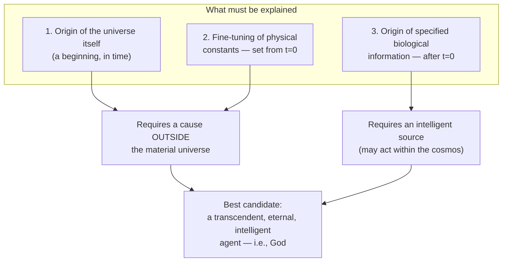

# From "Designer" to Theistic Implications

The design-detection method itself is agnostic about the designer's *identity* — only that *some* intelligence is responsible. But Meyer argues three requirements together point specifically to a **transcendent** designer (theism), not an immanent one (e.g., an alien, panspermia):

**Why not an immanent intelligence (alien / panspermia)?**
- Any prior "seeding" life just relocates the information-origin problem — it doesn't solve it.
- An intelligence *within* the cosmos, bound by its laws, cannot have set the constants and initial conditions that *predate and enable* its own existence.
- Only an agent existing independently of the material universe (timeless, or in a time independent of ours) can account for **all three** requirements above simultaneously.
