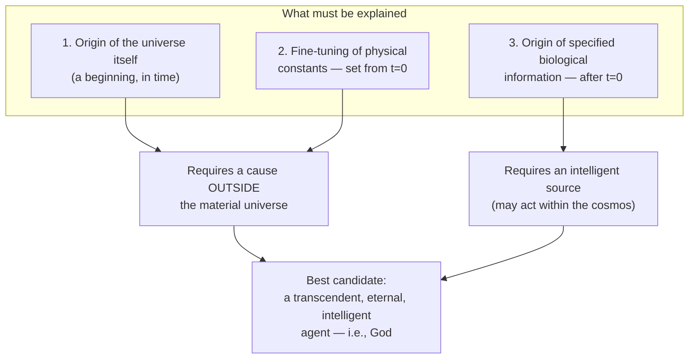

# From "Designer" to Theistic Implications

### The scene

Holmdel, New Jersey, 1964. Two radio astronomers at Bell Labs, Arno Penzias and Robert Wilson, cannot get rid of a faint hiss in their antenna. It comes from every direction, day and night. They point the antenna at New York City, and the hiss does not change. They clear out the pigeons nesting inside and clean up the droppings. The hiss stays. It turns out to be the oldest light there is: the afterglow of the beginning of the universe. [Source: [American Physical Society](https://aps.org/programs/honors/history/historicsites/penziaswilson.cfm); Nobel Prize in Physics 1978]

The universe had a beginning. That one fact changes what kind of designer could be behind it.

### The argument

The design-detection method does not say *who* the designer is. It only says that *some* intelligence is responsible. But Meyer argues that three things, taken together, point to a **transcendent** designer (theism): one beyond the universe, not an immanent one inside it (for example an alien, or panspermia, the idea that life was seeded on earth from space).

**Why not an intelligence inside the universe (alien / panspermia)?**
- Life "seeded" from somewhere else only moves the question of where the information came from. It does not answer it.
- An intelligence *within* the cosmos, bound by its laws, cannot have set the constants and starting conditions that *came before it and made it possible*.
- Only an agent that exists independently of the material universe (timeless, or in a time independent of ours) can account for **all three** at once.

**Meyer's point in one line: whoever set the stage could not have been standing on it.**
