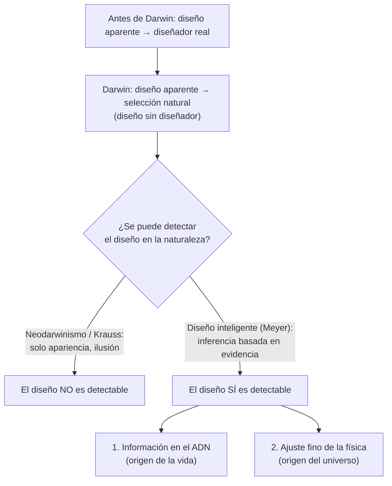

# La pregunta central

### La escena

Cambridge, Inglaterra, hacia 1830. Un joven estudiante llamado Charles Darwin se prepara para sus exámenes, y hay un autor que le encanta: William Paley. El argumento más conocido de Paley es sencillo. Si encuentras un reloj tirado en el suelo, sabes que lo hizo un relojero. Los seres vivos son mucho más complejos que cualquier reloj, así que también deben tener quien los hizo. Darwin escribió después que la lógica de Paley le dio "tanto deleite como Euclides". [Darwin, *Autobiografía*]

Unos treinta años después, ese mismo hombre publicó el libro que convenció a buena parte del mundo de que el relojero no hacía falta.

### La pregunta

Antes de Darwin, los biólogos explicaban la complejidad ordenada de la vida como Paley: la hizo una mente diseñadora. Darwin propuso que la selección natural, actuando sobre variaciones al azar, podía producir la *apariencia* de diseño sin ningún diseñador. Los neodarwinistas modernos extendieron esa idea a toda la biología. Algunos físicos dicen hoy algo parecido del universo: su ajuste fino para la vida sería solo "la ilusión de diseño".

El ensayo de Meyer sostiene lo contrario. El diseño no es solo una apariencia. Es **detectable científicamente**, y lo muestran dos líneas de evidencia independientes.

**Los dos lados están de acuerdo en que la naturaleza parece diseñada. Todo el debate es si esa apariencia dice la verdad.**
