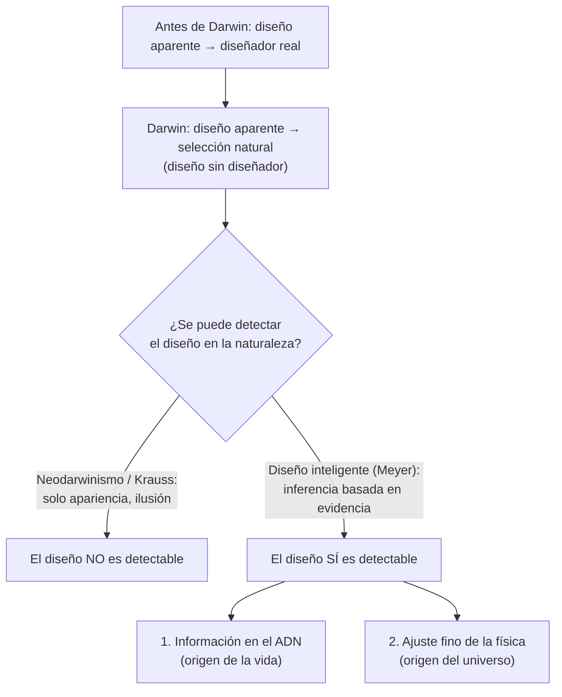

# La pregunta central

Antes de Darwin, los biólogos atribuían la complejidad organizada de la vida a una inteligencia diseñadora. Darwin propuso que la selección natural más la variación aleatoria podían producir la *apariencia* de diseño sin un diseñador real. Los neodarwinistas modernos extendieron esto a toda la biología; algunos físicos hacen hoy un movimiento parecido con el ajuste fino del cosmos (atribuyéndolo a "la ilusión de diseño").

El ensayo de Meyer sostiene lo contrario: el diseño no es solo aparente, sino **detectable científicamente**, por dos líneas de evidencia independientes.

