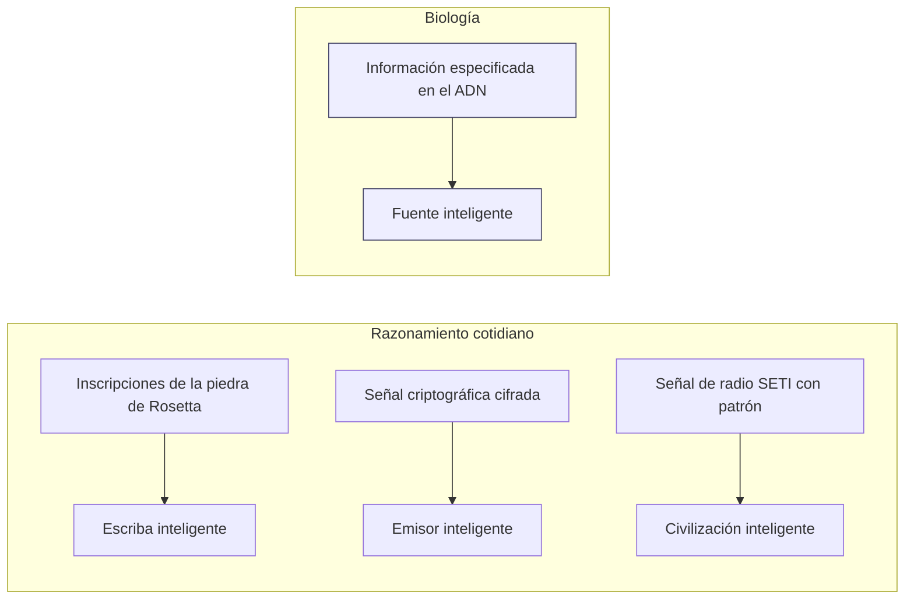

# Primera línea de evidencia: la información en el ADN

### El descubrimiento
- **1953**: Watson y Crick. El ADN guarda información como un código digital de cuatro caracteres (las bases nucleótidas).
- **La "hipótesis de la secuencia" de Crick**: las bases del ADN funcionan como letras o símbolos; su orden determina la función, exactamente como en el lenguaje escrito o en el código de computadora.
- El ADN tiene más que *información de Shannon* (improbabilidad matemática): tiene **información especificada o funcional**, una secuencia que es compleja *y además* cumple una función específica.

> "El ADN es como un programa de computadora, pero mucho, mucho más avanzado que cualquier software que hayamos creado." — Bill Gates
> "El código máquina de los genes se parece asombrosamente al de una computadora." — Richard Dawkins

### La lógica para detectar diseño (Dembski)
Un sistema se atribuye con confianza a una causa inteligente cuando muestra **ambas** cosas:
1. **Alta complejidad** (baja probabilidad; no responde a una regla o algoritmo simple), **y**
2. **Especificación** (coincide con un patrón reconocible de forma independiente o con un requisito funcional).

| # | Secuencia | ¿Compleja? | ¿Especificada? | ¿Inferencia de diseño? |
|---|---|:---:|:---:|:---:|
| 1 | `nehya53nslbyw1'jejns7eopslanm46/J` | ✅ | ❌ | No: compleja pero sin sentido |
| 2 | `EL TIEMPO Y LA MAREA NO ESPERAN A NADIE` | ✅ | ✅ | **Sí: cumple ambos criterios** |
| 3 | `ABABABABABABABABABABAB` | ❌ | ✅ (trivial/periódica) | No: ordenada pero no compleja |

Las regiones codificantes del ADN cumplen **ambos** criterios, igual que la secuencia n.º 2. Por la misma lógica que se usa todos los días en arqueología, criptografía, investigación de fraudes y SETI, la presencia de información especificada permite inferir una fuente inteligente.

**¿Por qué no el azar, la ley o la evolución misma?**
- *El azar*: demasiado improbable; simplemente hay demasiada información en la célula.
- *La ley o la química*: explican la regularidad, no la secuencia especificada (analogía: la química de la tinta y el papel no explica el titular de un periódico).
- *La selección natural prebiótica*: presupone justo lo que necesita explicar, la información genética preexistente.
