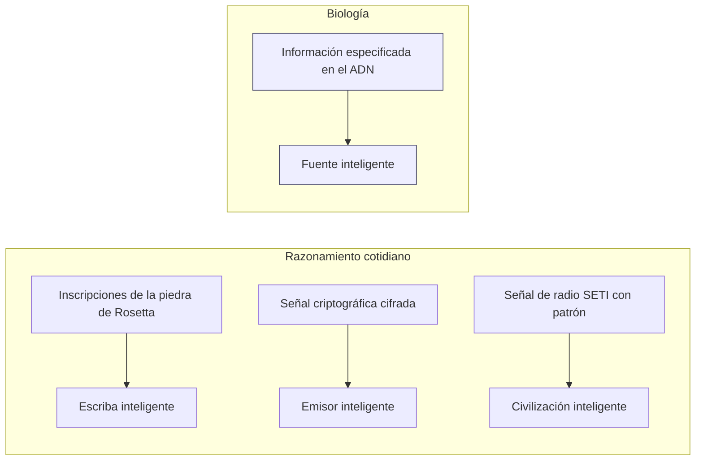

# Primera línea de evidencia: la información en el ADN

### El descubrimiento
- **1953**: Watson y Crick. El ADN guarda información como un código digital de cuatro caracteres (las bases nucleótidas).
- **La "hipótesis de la secuencia" de Crick**: las bases del ADN funcionan como letras o símbolos. Su orden decide lo que hacen, exactamente como en el lenguaje escrito o en el código de computadora.
- El ADN tiene más que *información de Shannon* (una secuencia que solo es improbable). Tiene **información especificada, o funcional**: una secuencia que es compleja *y además* cumple una tarea específica.

> "El ADN es como un programa de computadora, pero mucho, mucho más avanzado que cualquier software que hayamos creado." — Bill Gates
> "El código máquina de los genes se parece asombrosamente al de una computadora." — Richard Dawkins

### La lógica para detectar diseño (Dembski)
¿Cómo sabemos que algo salió de una mente? Lo sabemos con confianza cuando muestra **las dos** cosas:
1. **Alta complejidad** (es muy improbable, y ninguna regla o fórmula simple la produce), **y**
2. **Especificación** (coincide con un patrón que podemos reconocer por separado, o cumple una tarea).

| # | Secuencia | ¿Compleja? | ¿Especificada? | ¿Inferencia de diseño? |
|---|---|:---:|:---:|:---:|
| 1 | `nehya53nslbyw1'jejns7eopslanm46/J` | ✅ | ❌ | No: compleja pero sin sentido |
| 2 | `EL TIEMPO Y LA MAREA NO ESPERAN A NADIE` | ✅ | ✅ | **Sí: cumple ambos criterios** |
| 3 | `ABABABABABABABABABABAB` | ❌ | ✅ (trivial/periódica) | No: ordenada pero no compleja |

Las regiones codificantes del ADN pasan **las dos** pruebas, igual que la secuencia n.º 2. Usamos este mismo razonamiento todos los días en arqueología, en el descifrado de códigos, en la investigación de fraudes y en SETI (la búsqueda de señales de otras civilizaciones). Por ese razonamiento, la información especificada apunta a una fuente inteligente.

**¿Por qué no el azar, la ley o la evolución misma?**
- *El azar*: demasiado improbable. Simplemente hay demasiada información en la célula.
- *La ley o la química*: una ley explica el orden regular y repetido, no un mensaje específico. (La química de la tinta y el papel no explica el titular de un periódico.)
- *La selección natural prebiótica* (antes de que existiera la vida): da por supuesto justo lo que necesita explicar, una información genética que ya está ahí.

**El punto de Meyer: cada vez que hemos rastreado un mensaje en código hasta su origen, hemos encontrado una mente. Él pregunta por qué el ADN tendría que ser la única excepción.**
