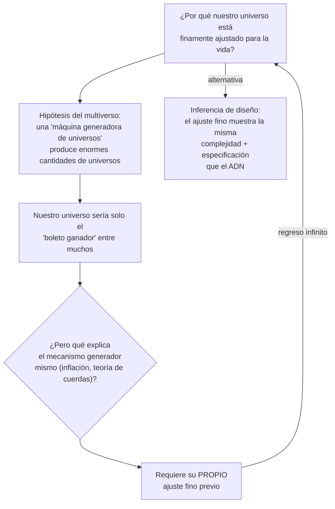

# Segunda línea de evidencia: el ajuste fino del cosmos

### La escena

Pasadena, California, 1953. El astrónomo inglés Fred Hoyle, ateo, entra a un laboratorio de física nuclear de Caltech con una petición extraña. Las estrellas, dice, nunca podrían fabricar carbono a menos que el núcleo del carbono tenga cierto nivel de energía, en un valor exacto, que nadie ha visto jamás. Tiene que estar ahí, porque estamos hechos de carbono y aquí estamos. Los físicos dudan, hacen el experimento y encuentran el nivel casi exactamente donde él dijo. [Documentado: el "estado de Hoyle" del carbono 12]

Años después, Hoyle escribió la frase que se cita abajo. Los números, reconoció, parecían arreglados.

### Lo que encontraron los físicos

Desde los años cincuenta y sesenta, los físicos han descubierto que las leyes, las constantes y las condiciones iniciales del universo están finamente ajustadas, contra probabilidades extremas, para permitir la vida (y hasta la química básica). Ejemplos citados: la tasa de expansión del universo, la velocidad de la luz, las masas de los quarks y la intensidad de la gravedad y de la fuerza electromagnética.

> "La impresión de diseño es abrumadora." — Paul Davies
> "Una interpretación de sentido común de los hechos sugiere que un superintelecto ha jugado con la física." — Fred Hoyle

### El contraargumento del multiverso, y su problema

La respuesta principal es el multiverso: quizá hay una cantidad enorme de universos, cada uno con ajustes distintos, y al nuestro simplemente le tocó el boleto ganador. Meyer responde que lo que produzca todos esos universos necesitaría, a su vez, un ajuste cuidadoso.

La conclusión de Meyer: toda explicación materialista del ajuste fino termina recurriendo a otro ajuste fino que tampoco está explicado. Da por supuesto lo que debía explicar. Y como el ajuste fino muestra la misma firma de **complejidad + especificación** que justifica las inferencias de diseño en otros campos, el diseño inteligente sigue siendo la mejor explicación.

**El multiverso no quita el ajuste fino. Solo lo sube un piso.**
