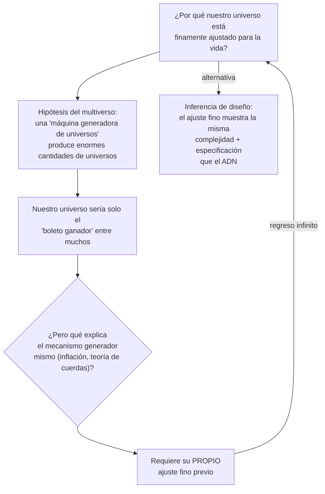

# Segunda línea de evidencia: el ajuste fino del cosmos

Desde los años cincuenta y sesenta, los físicos han descubierto que las leyes, las constantes y las condiciones iniciales del universo están finamente ajustadas, contra probabilidades extremas, para permitir la vida (y hasta la química básica). Ejemplos citados: la tasa de expansión del universo, la velocidad de la luz, las masas de los quarks y la intensidad de las fuerzas gravitatoria y electromagnética.

> "La impresión de diseño es abrumadora." — Paul Davies
> "Una interpretación de sentido común de los hechos sugiere que un superintelecto ha jugado con la física." — Fred Hoyle

### El contraargumento del multiverso, y su problema

La conclusión de Meyer: toda explicación materialista del ajuste fino termina invocando otro ajuste fino sin explicar, es decir, da por supuesto lo que debe probar. Como el ajuste fino muestra la misma firma de **complejidad + especificación** que justifica las inferencias de diseño en otros campos, el diseño inteligente sigue siendo la mejor explicación.
