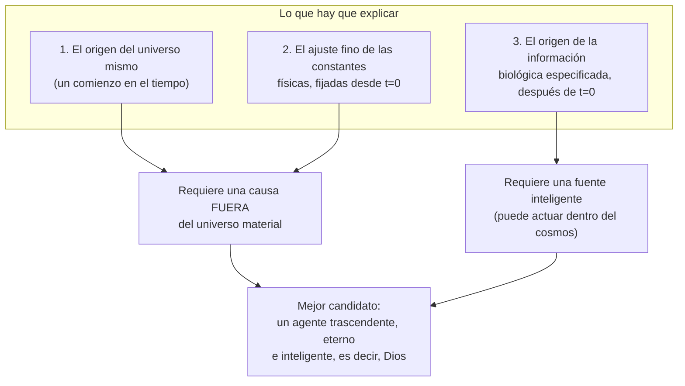

# Del "diseñador" a las implicaciones teístas

El método para detectar diseño no dice por sí mismo *quién* es el diseñador, solo que *alguna* inteligencia es responsable. Pero Meyer sostiene que tres requisitos juntos apuntan a un diseñador **trascendente** (teísmo), no a uno inmanente (por ejemplo, un extraterrestre o la panspermia):

**¿Por qué no una inteligencia inmanente (extraterrestre o panspermia)?**
- Cualquier "siembra" previa de vida solo traslada el problema del origen de la información; no lo resuelve.
- Una inteligencia *dentro* del cosmos, sujeta a sus leyes, no pudo fijar las constantes y condiciones iniciales que *preceden y hacen posible* su propia existencia.
- Solo un agente que existe con independencia del universo material (fuera del tiempo, o en un tiempo independiente del nuestro) puede explicar **los tres** requisitos a la vez.
