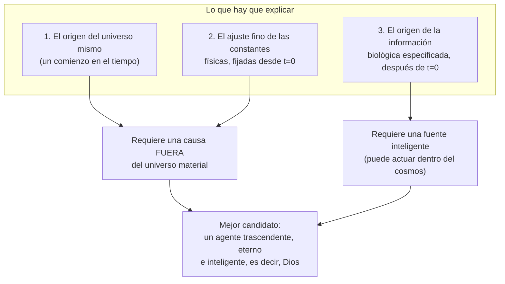

# Del "diseñador" a las implicaciones teístas

### La escena

Holmdel, Nueva Jersey, 1964. Dos radioastrónomos de los Laboratorios Bell, Arno Penzias y Robert Wilson, no logran quitar un zumbido débil de su antena. Viene de todas direcciones, de día y de noche. Revisan los cables. Sacan a las palomas que anidan adentro y limpian el excremento. El zumbido sigue. Resulta ser la luz más antigua que existe: el resplandor que quedó del comienzo del universo. [Documentado: Penzias y Wilson, 1965; Premio Nobel de Física 1978]

El universo tuvo un comienzo. Ese solo hecho cambia qué clase de diseñador puede estar detrás.

### El argumento

El método para detectar diseño no dice *quién* es el diseñador. Solo dice que *alguna* inteligencia es responsable. Pero Meyer sostiene que tres cosas, tomadas juntas, apuntan a un diseñador **trascendente** (teísmo): uno que está más allá del universo, no uno inmanente, dentro de él (por ejemplo, un extraterrestre, o la panspermia, la idea de que la vida fue sembrada en la tierra desde el espacio).

**¿Por qué no una inteligencia dentro del universo (extraterrestre o panspermia)?**
- Una vida "sembrada" desde otro lugar solo cambia de sitio la pregunta de dónde salió la información. No la responde.
- Una inteligencia *dentro* del cosmos, sujeta a sus leyes, no pudo fijar las constantes y condiciones iniciales que *existieron antes que ella y la hicieron posible*.
- Solo un agente que existe con independencia del universo material (fuera del tiempo, o en un tiempo independiente del nuestro) puede explicar **las tres** a la vez.

**Quien preparó el escenario no podía estar parado en él.**
